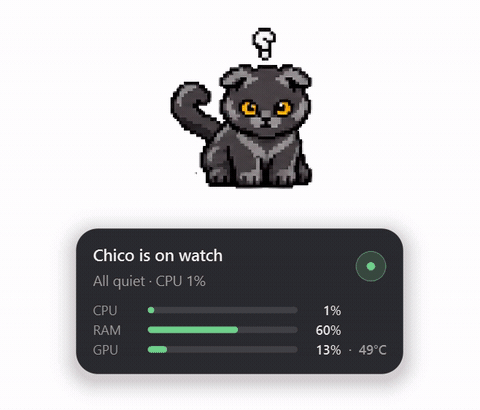

# LC-pet-stat — Layla & Chico

A frameless, always-on-top desktop pet for Windows. Two cats sit on your desktop and react to
live system load through state-driven sprite animations. Hover them for a translucent stats
card; drag them anywhere; steer them from the tray.



---

## What it does

The pets read CPU, RAM, GPU, swap, disk and idle time once every 1.5 s on a worker thread, and
pick one of ten animations to match. The mapping is a priority ladder with Schmitt-trigger
hysteresis and a minimum dwell time, so the pet settles into a state rather than flickering at a
threshold boundary.

| State | Frames | Roughly when |
| --- | --- | --- |
| `idle-attentive` | 8 | the calm default — CPU below 20% |
| `running-playful-roll` | 8 | moderate load, CPU 20–60% |
| `running-busy-play` | 8 | moderate load (one-shot flourish, holds its last frame) |
| `running-playful-jump` | 10 | heavy load — CPU above 80% or RAM above 85% |
| `working-together` | 8 | you are actively typing at the keyboard |
| `waiting-dozy` | 8 | no input for 1 minute |
| `waiting-deep-sleep` | 8 | no input for 15 minutes |
| `blocked-grumpy` | 8 | temperature above 80 °C, or heavy swap use |
| `ready-pleased` | 8 | a sustained CPU spike drops back to calm — also the greeting on click/drag |
| `needs-input-sad` | 8 | no telemetry trigger; reachable from the tray's **Poke the pets** |

Idle isn't static: every five minutes the pet plays a weighted random flourish (a roll, a busy
play, a wave) so a quiet desktop still has some life in it.

**Typing detection is deliberately non-invasive.** It uses `GetLastInputInfo`, the same Win32
call screensavers use — a timestamp of the last input event, sampled at 250 ms. There is no
keyboard hook, no `GetAsyncKeyState` polling, no raw input capture, and nothing that records
*what* you type. Only *that* something happened.

## Features

- **Frameless translucent overlay** — `FramelessWindowHint` + `WA_TranslucentBackground` +
  `WindowStaysOnTopHint`, with `Qt.Tool` so it stays out of the taskbar and Alt-Tab.
- **Drag to move** — left-click drag, with click-vs-drag separated by the platform's own
  `startDragDistance()`. Position persists across restarts, per screen.
- **Hover stats card** — a semi-transparent panel showing CPU, RAM, GPU, temperature, swap,
  disk and uptime. Click the pet to pin it open.
- **Click-through mode** — the pet becomes decorative and clicks pass to whatever is beneath it
  (`WS_EX_TRANSPARENT`). Only ever enabled when the tray icon exists, so there is always a way
  back out.
- **System tray** — toggle click-through, pet visibility, always-on-top and the stats card;
  reset position; poke the pets into any state; quit.
- **Alpha-accurate hit testing** — hovering is tested against the sprite's actual opaque pixels,
  not its bounding box, so the transparent gutter below the cats isn't hoverable.

## Requirements

- Windows 10 or 11
- [pixi](https://pixi.sh) (developed against 0.72)

macOS and Linux are not supported yet. The platform-specific code sits behind a small seam
(`src/core/platform/`) with a working null backend, so adding them is a contained job rather
than a rewrite — but it hasn't been done or tested.

## Running it

```powershell
pixi install          # materialize the environment from pixi.lock
pixi run pets         # start the pets
```

Useful variants:

```powershell
pixi run pets --validate   # check the sprite atlas and exit, no GUI
pixi run pets --debug      # verbose logging
```

## Development

```powershell
pixi run -e dev test                    # full suite (~60 s)
pixi run -e dev test -m "not slow"      # fast subset, skips the wall-clock tests
pixi run check                          # frame QA gate over every art sequence
pixi run qa                             # frame QA notebook in JupyterLab
```

There are three pixi environments, and the split is intentional:

| Environment | Holds | Why |
| --- | --- | --- |
| `pets` | PyQt6, psutil, numpy, nvidia-ml-py | the runtime — 70 packages, deliberately lean |
| `dev` | the above plus pytest | the test suite, kept out of the runtime surface |
| default | napari, JupyterLab, Pillow | the art pipeline, which the app never touches |

Notably **Pillow is not a runtime dependency**. The atlas is decoded and sliced with Qt's own
`QImage`, which makes a whole class of buffer-lifetime bug unrepresentable rather than merely
fixed. A test asserts it never creeps back in.

## Project layout

```
src/
  main.py               entry point and wiring — no behaviour of its own
  config.py             every tunable: thresholds, timings, copy, presentation
  core/
    sprite_loader.py    atlas PNG + JSON -> per-frame QPixmaps
    animator.py         drift-free per-frame playback
    state_machine.py    the telemetry -> state ladder
    telemetry.py        worker-thread metrics sampling
    platform/           OS-specific window tricks behind an abstract seam
  ui/
    pet_window.py       the overlay window, drag, hit testing
    stats_card.py       the hover card
    tray.py             tray icon and menu
assets/
  layla-and-chico-pet-spritesheet.png/.json   the only two files needed at runtime
  gen-image/                                  the art pipeline, one folder per sequence
docs/
  BuildPlan.md          the original spec
  PHASE1-CONTRACT.md    the interface contract the modules were built against
  PHASE1-LOG.md         what was built, what broke, and what was measured
tests/                  14 modules, 222 tests
tools/frame_qa.py       the art QA gate
```

## Sprites

The atlas is 1920×2080 — ten rows of ten 192×208 frames, 82 frames in use. Per-frame timings
live in the sidecar JSON and are read verbatim, so an animation can hold one frame longer than
another without any code change.

Art is generated per sequence through the pipeline in
[`docs/codex-animation-pipeline-guide.md`](docs/codex-animation-pipeline-guide.md) and gated by
`pixi run check` before it ships. New states can be added to the state machine *before* their art
exists — an unavailable row is simply never emitted, and starts working the day it lands in the
atlas.

## Status

Phase 1. The app runs, the state machine is fully wired, and the test suite is green. Known gaps
are tracked in [`docs/PHASE1-LOG.md`](docs/PHASE1-LOG.md) — the honest version, including the
swap threshold that is still an unvalidated guess and the jump animation whose airborne frames
don't actually leave the ground.

## License

Not yet chosen. Until this section says otherwise, all rights reserved.

---

Layla and Chico are real cats. Any resemblance to your system load is intentional.
