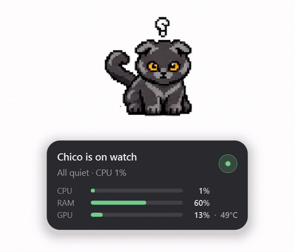

{fig-alt="Two cats, Layla and Chico, animating on the desktop" fig-align="center"}

DeskPets puts two small cats, **Layla** and **Chico**, on your Windows desktop. They stay on top of your windows and change what they do based on how busy your system is and what you are doing. Hover over them and a small card shows the actual numbers. The goal is to answer one question at a glance, without opening a monitoring dashboard: *is my computer calm, busy, struggling, or waiting for me?*

::: {.callout-note}
## Status
DeskPets is a personal project in active development. The Windows app is built and runs. A one-click installer is in progress and not released yet, so for now you run it from source.
:::

## Features {#features}

- **Live system state.** CPU, RAM, swap, GPU, temperature, disk, battery and idle time, shown only for the hardware you actually have.
- **Hover stats card.** Details on demand.
- **Stays out of the way.** Always on top, transparent, and lightweight, with an optional click-through mode.
- **Tray control.** Show or hide the pets, reset their position, and preview any animation.
- **Pomodoro timer.** A 45 minute focus timer. When it finishes the pets celebrate and you hear a chime. Take a break, stretch out, and let your ADHD brain get interested again!
- **Private by design.** Input detection only reads how long you have been idle. There is no keyboard hook, and nothing is logged or sent anywhere.

## Start here

- [**Getting started**](guide/getting-started.qmd): run it in four lines.
- [**Pets and states**](guide/pets-and-states.qmd): what each animation means.
- [**About**](project/about.qmd): why it exists, how it was built, and where it's going.

The source and issues are on [GitHub](https://github.com/Suyash-Naik/DeskPets).
