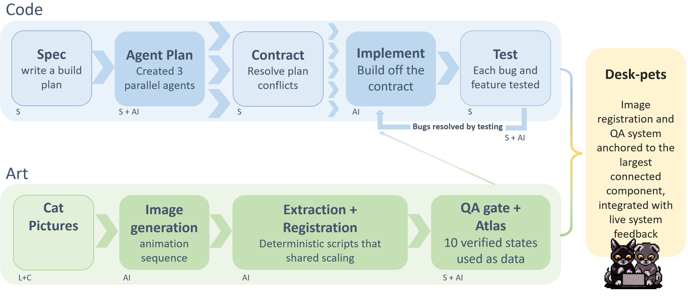

I directed DeskPets and wrote the specs and instructions. Claude drafted the code and the documentation, and Codex produced the art, all from my prompts. I reviewed, corrected, and tested everything before it was committed. This page shows how that worked in practice.

## The pipeline at a glance

DeskPets was built as two tracks that ran side by side: **code** and **art**. The diagram marks who did each step.

{fig-alt="Two pipelines. Code: Spec, Agent Plan, Contract, Implement, Test, with a bugs-resolved-by-testing loop. Art: Cat Pictures, Image generation, Extraction and Registration, QA gate and Atlas. Both feed DeskPets." fig-align="center"}

::: {.callout-note}
## How to read the labels
- **S** is me, doing it directly.
- **AI** is an agent doing it from my prompts.
- **S + AI** is both of us working on the step together.
- **L + C** is Layla and Chico, the cats the art is based on.
:::

| Track | Step | Who | What happened |
| --- | --- | --- | --- |
| Code | Spec | S | I wrote a build plan. |
| Code | Agent plan | S + AI | Three planning agents each designed one part, in parallel. |
| Code | Contract | S | I resolved the places where their plans disagreed. |
| Code | Implement | AI | Agents built each module from the contract. |
| Code | Test | S | I tested every feature and bug. |
| Code | Bugs resolved by testing | S + AI | I found problems by running the app, and directed agents to fixes. |
| Art | Cat pictures | L + C | Photos and reference images of the real cats. |
| Art | Image generation | AI | Codex generated each animation sequence from my prompts. |
| Art | Extraction and registration | AI | Deterministic scripts cut out and align the frames at one shared scale. |
| Art | QA gate and atlas | S + AI | An automated check plus my review. The ten verified states are packed into one sprite atlas. |

## The code track

### 1. Spec: a build plan

I started from a written plan of what the app should do. It is [`BuildPlan.md`](https://github.com/Suyash-Naik/DeskPets/blob/main/docs/BuildPlan.md): a prototype sketch with the goal, the states, and the planned structure. It was a starting point and was later superseded in places due to requirements.

### 2. Agent plan: three planners in parallel

Before any code, three planning agents each designed one part of the app: the frameless always-on-top window, the drag and click-through behavior, and the status card with live telemetry. They worked at the same time against a shared module skeleton. This was deliberate. Independent plans surface disagreements that a single pass would paper over.

### 3. Contract: settling the conflicts

The parallel plans produced seven real conflicts. One example: the rendering plan had the animator fall back to idle on its own when a one-shot animation ended, while the telemetry plan had the animator hold the last frame and leave the reverting to the state machine. Each is reasonable alone, but together they race and the pet ping-pongs. I settled on one owner for the decision: the animator holds, and the state machine reverts.

All seven decisions, with the losing option noted, are written into one document, [`PHASE1-CONTRACT.md`](https://github.com/Suyash-Naik/DeskPets/blob/main/docs/PHASE1-CONTRACT.md). It is the single authoritative spec: module ownership, exact interfaces, and the checks every implementer must run. It overrides anything in an individual plan.

### 4. Implement: building off the contract

Implementation fanned out in waves, one agent per module, each building to the contract. The rule for every agent was to **run** its module against real data and not just write it.

### 5. Test, and the loop back

I tested every feature and every bug. Anything that failed was fixed, and tested again. This loop is where most of the real defects were found, and the [build log](https://github.com/Suyash-Naik/DeskPets/blob/main/docs/PHASE1-LOG.md) records them. Two examples:

- A drawing call passed the wrong point type, which silently killed the whole app (exit code 9, no traceback) the moment the CPU went high.
- A visibility signal and a pause method had opposite meanings, so the pets froze the instant they appeared. A smoke test that counted frames caught it: none arrived in 2.2 seconds where about fifteen were expected.

Neither would have been found by reading the code. That is why "run the artifact before calling it done" is a rule in the project's instructions to the agents as that ensured consistencies and allowed automation.

## The art track

I ran the art track in parallel as I was working on the code. Talk about peak ADHD multitasking (_my therapist recommends against_)! Codex generated each animation from my prompts, and the work moves through four steps:

1. **Cat pictures:** photos and reference images of Layla and Chico.
2. **Image generation:** one strip per animation, from a long, exact prompt. See [Generating sprites with Codex](generating-sprites.qmd).
3. **Extraction and registration:** deterministic scripts clean up each strip, cut it into frames, and align them at one shared scale. Alignment is anchored to the largest connected shape in each frame, so a detached prop or effect can't pull the cat sideways.
4. **QA gate and atlas:** an automated checker reviews every sequence and I review the motion by eye. The approved frames are packed into one atlas. See [Art pipeline](art-pipeline.qmd).

## Where the two tracks meet

The code never hard-codes the art. It reads the ten animations as data from the atlas, so the code track could keep moving while the sprites were still changing. That is also why a state can ship before its art exists. The registration and QA system sits between the tracks and is what lets the finished atlas drive the app from live system readings.

## The files behind this

The working documents are in the repository, if you want to see the process and not just the summary:

- [`PHASE1-CONTRACT.md`](https://github.com/Suyash-Naik/DeskPets/blob/main/docs/PHASE1-CONTRACT.md): the contract the agents built to.
- [`PHASE1-LOG.md`](https://github.com/Suyash-Naik/DeskPets/blob/main/docs/PHASE1-LOG.md): what was built, what was decided, what broke.
- [`CLAUDE.md`](https://github.com/Suyash-Naik/DeskPets/blob/main/CLAUDE.md) and [`AGENTS.md`](https://github.com/Suyash-Naik/DeskPets/blob/main/AGENTS.md): the standing instructions each agent works under.
