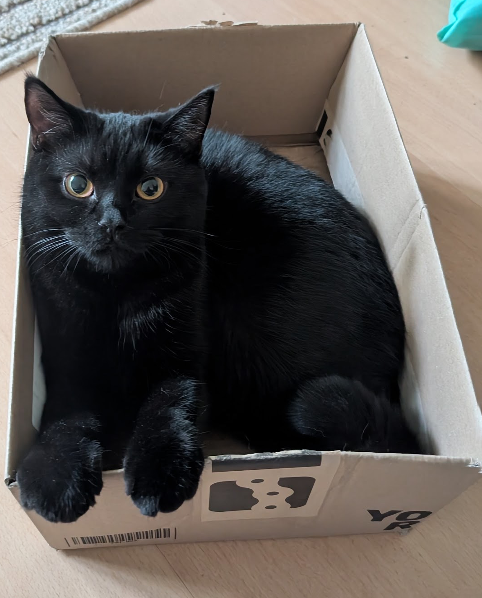
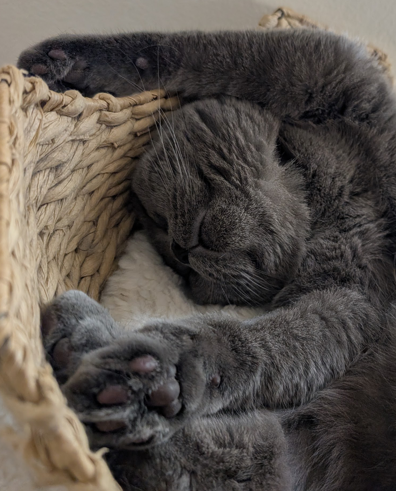

This is the story that goes deeper into my thoughts behind [DeskPets](/index.qmd): what it is meant to be, how it was made, and the goals.

## Where it started

DeskPets began when I was running a Docker-based virtual machine on a modest home PC and kept losing track of how much of the machine I was using. I wanted immediate visual feedback without having to open a monitoring dashboard, and I wanted it to feel personal. I adopted Layla and Chico last year, so I based the pets on them.

## What it is, and what it isn't

DeskPets should answer a simple question without interrupting my work: *is my computer calm, busy, struggling, or waiting for me?* It is meant to:

- give immediate visual feedback about system load;
- make it easier to notice **sustained** CPU, RAM, GPU, temperature or swap pressure, and not just a momentary spike;
- stay lightweight and unobtrusive during normal work;
- show detailed telemetry only when I ask for it, by hovering over the pets; and
- make routine system monitoring feel more personal and enjoyable.

It is a companion, not a diagnostic or benchmarking tool. The animations summarize the current state, and the stats card provides the underlying numbers when I need them.

## Meet Layla and Chico

The pets are based on my two cats.

::: {.columns}
::: {.column width="50%"}
**Layla** is the slimmer black cat with upright, pointed ears, pale paw socks and chest markings, and amber eyes.
{fig-alt="Layla, the black cat with upright ears and amber eyes" fig-align="center" width="65%"}
:::

::: {.column width="50%"}
**Chico** is the rounder, lighter charcoal cat with folded ears, full cheeks, and amber eyes.
{fig-alt="Chico, the rounder charcoal cat with folded ears and amber eyes" fig-align="center" width="65%"}
:::
:::

They love to cuddle together.

## How it was built

The idea came to me in a spurt of ADHD frustration and inspiration. Keeping track of computer vitals while actively exploring and working on other projects is an arduous ask for an attention-deficient mind, so I wanted to make it easier.

I directed the project and wrote the specs and instructions. Claude drafted the code and documentation, I reviewed and released it. I prompted Codex to produced the art to use its inbuilt image generation modules. I corrected and tested everything before commits. The process is described in [Built with agents](/internals/built-with-agents.qmd), and the artwork has its own page: [Art pipeline](/internals/art-pipeline.qmd).

### Agentic AI

A broader goal of the project is to learn how desktop software can be integrated with agentic AI. I would like to add a small chat window that lets Layla and Chico interact with large language models, so the pets become a friendly interface and not only a visual indicator. They could help answer questions, explain what is happening on the computer, and eventually do useful tasks.

It would also give me a practical way to explore the parts of agentic software that interest me most: connecting an LLM to live application context, giving it carefully scoped tools, and turning its responses into actions that stay understandable and under my control. The exact features are still open. I want the AI integration to grow naturally out of the pets and not feel like a separate assistant placed on top of them.

::: {.callout-note}
None of this is built yet. It is a direction, not a feature.
:::

### Other platforms

Windows is the current target. Linux and macOS support will follow later as time allows. Their desktop and window-management behavior needs dedicated platform work and is not a simple packaging change.

---

The project will keep evolving around its original purpose: giving me a quick sense of my computer's health while keeping Layla and Chico close during the day.
